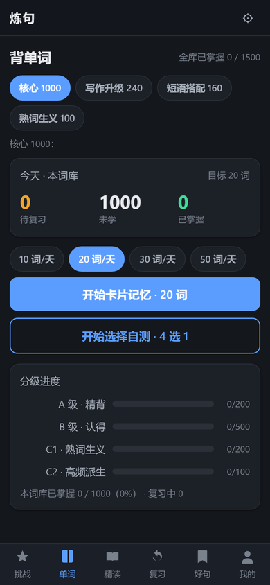
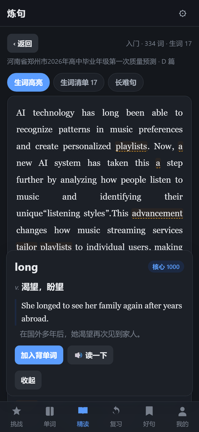

# 炼句 · 高三英语阅读工具

一个纯静态网页，用 **70 份高三英语模拟卷**统计出的词表来背单词，用 **真题原文**来练精读。
零依赖、零后端、离线可用，双击 `index.html` 就能跑。

适用于新高考 I 卷地区的高三学生。完全免费，不注册，不收集任何数据。

**在线直接用：<https://destinhue.github.io/lianju/>**
（手机上打开后，浏览器菜单里选“添加到主屏幕”，和 App 一样用）

<p align="center">
  
  <br><sub>背单词：4 个词库共 1500 条</sub>
</p>
<p align="center">
  
  <br><sub>卡片式记忆，认识 / 不熟二选一</sub>
</p>
<p align="center">
  
  <br><sub>精读：60 篇真题按难度分级</sub>
</p>
<p align="center">
  
  <br><sub>点任意单词出释义</sub>
</p>
<p align="center">
  
  <br><sub>长难句自动挑出来</sub>
</p>
<p align="center">
  
  <br><sub>炼句：一句中文写英文</sub>
</p>

---

## 它解决什么问题

读英语阅读读不下去，通常不是"语法不会"，而是**词不够**：

- 认得每个词，但一句话读完不知道在说什么；
- 生词多到要查十几次，查完又忘了原文讲什么；
- 背的单词书和卷子上的词对不上，背了两千词还是卡。

这个工具的做法是：**不背单词书，背卷子里的词**。

## 功能

| 板块 | 说明 |
|---|---|
| 单词 | 4 个词库共 1500 条：核心 1000 / 写作 240 / 短语 160 / 熟词生义 100。每天 20 个，选"认识 / 不熟"，系统按 1→3→7→15 天自动排复习 |
| 精读 | 60 篇真题原文，按难度分三级。点任意单词出释义，生词一键加进背单词队列；长难句自动挑出并给结构提示 |
| 炼句 | 给一句中文，写英文，再对照 L1（及格）/ L2（良好）/ L3（优秀）三层表达 |
| 复习 | 到期该复习的词和句子自动回来找你 |
| 好句 | 收藏值得反复读的句子 |

## 怎么用

**电脑**：下载后双击 `index.html`，用 Chrome / Edge 打开即可。

**手机**：把整个文件夹（或压缩包）传到手机解压，用手机浏览器打开 `index.html`，
然后在浏览器菜单里选"添加到主屏幕"，之后就像 App 一样打开。

> 注意：数据存在浏览器的 localStorage 里，**清缓存会丢记录**。在「我的」页面里有导出备份。

## 词库是怎么来的

不是照抄某本单词书，是从真实卷子里统计出来的：

1. 从 70 份模拟卷（2025.02–2026.03）提取正文，得到 253k 词、139,854 个内容词 token 的语料；
2. 按词频 × 覆盖贡献排序，算出"要读懂 90% 的内容需要多少词"——约 5,165 词，
   但真正高频、值得高三学生优先掌握的不到 1,000 个；
3. 分层入库：A 级 200（精背）/ B 级 500（认得）/ C1 熟词生义 200 / C2 高频派生 100；
4. 再用三份专业方向的分库补齐"写得出"和"读得懂"的两头：
   写作 240 条（情绪/动作/环境/评价/过渡）、短语 160 条、熟词生义 100 条。

统计脚本不随仓库发布（依赖原始卷子文件），但方法论与阈值写在词库字段里，可复核。

## 目录结构

```
index.html          入口，负责按顺序加载所有脚本
app.js              路由与全局状态
styles.css          全部样式（移动端优先）
core/               纯逻辑：SRS 排程、词库、精读分析、校验、生成链路
views/              六个板块的视图
data/               所有数据，以 .js 形式提供（见下方说明）
docs/shots/         截图
```

**为什么数据是 `.js` 而不是 `.json`**：这样用 `file://` 双击打开时不会被 CORS 拦死。
没有构建步骤，没有 npm，改完刷新浏览器就生效。

## 已知限制

- 记录只存在本机浏览器，不跨设备同步（这是刻意的：不需要账号，也就没有服务器）。
- 词表与释义为自制约 1500 条，不是权威词典，个别释义按高考语境做了取舍。
- 精读文章的"生词数"以"不在词库内且不在前 3000 高频词内"口径统计，是参考值。
- 可选的 AI 查词需要自备 DeepSeek API Key，不填也能用全部核心功能。

## 数据来源与免责声明

- 精读文章为**公开模拟卷的阅读文段原文**（已去除题目），每篇在数据里保留了来源标注，
  仅用于个人学习与教学交流，**非商业用途**。若权利人认为不妥，请提 Issue，会立即删除。
- 词表、释义、例句、代码为本项目自制。

## License

代码以 MIT 协议开源（见 [LICENSE](LICENSE)）。
词库数据与文章原文的版权归各自权利人，不在 MIT 授权范围内。
